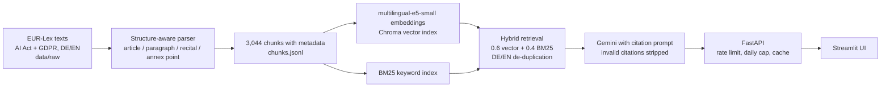

# EU AI Act + GDPR Assistant

A bilingual (German/English) retrieval-augmented assistant that answers questions about the EU AI Act and the GDPR, cites the exact article, and says "not covered" when the texts do not answer the question.

**Live demo:** coming soon (a screenshot will be added here once the Space is deployed).

> **Not legal advice.** Do not enter personal data. The demo is quota-limited (10 questions per IP per hour, 200 per day overall). Text as of: AI Act consolidated version 2026-07-27, GDPR 2016-05-04.

## What it does

- Ask in German or English (other languages are answered in English). Retrieval searches both language versions of the law and removes duplicates, so a German question can be answered from the English text and the other way round.
- The UI lists the cited provisions as sources (not every retrieved passage). Every answer carries numbered citations such as "GDPR Art. 17(1)" with a link to EUR-Lex. A model answer without a valid citation is turned into a "not covered" reply, never shown as a confident uncited answer.
- The assistant is instructed to refuse out-of-scope questions (refusal accuracy: pending full evaluation).
- FastAPI service with a per-IP rate limit, a daily cap and an answer cache; Streamlit UI on top.

## Architecture



## Results

Measured by `eval/run_eval.py` on a 40-question gold set (35 in-scope, 5 out-of-scope). The questions were written by the author and reviewed on 2026-11-23, so read the numbers as indicative, not as a benchmark. Full tables: [`eval/results.md`](eval/results.md), per question: [`eval/results_per_question.md`](eval/results_per_question.md).

| Retrieval metric (top 6) | Structure-aware chunks | Fixed-size chunks |
|---|---|---|
| Hit rate, article level | **82.9%** (n=35) | 54.3% (n=35) |
| Hit rate, paragraph level | **64.3%** (n=28) | 32.1% (n=28) |
| Retrieval latency p50 / p95 | 26 / 30 ms | 23 / 26 ms |

"Hit" means at least one expected provision is among the six retrieved results.

**Answer quality (citation correctness, refusal accuracy, LLM-judged faithfulness and relevance, answer latency, tokens): pending.** These need an LLM API key and have not been run yet; the numbers will be added when they exist.

**Chunking finding.** Cutting the law along its own structure (one chunk per article paragraph, recital or annex point, each starting with its heading) found the right provision far more often than cutting every fixed number of characters, 82.9% vs 54.3% at article level. Fixed-size pieces lose which article they belong to and split legal statements in the middle. Measured with the same embedding model, same index settings and same questions.

## Tech stack

Python 3.12, uv, LangChain (Chroma, Hugging Face embeddings, Google GenAI), sentence-transformers (`intfloat/multilingual-e5-small`, CPU), rank-bm25, FastAPI, Streamlit, pydantic-settings, pytest, ruff, Docker, GitHub Actions, Hugging Face Spaces.

## Run locally

```bash
uv sync
uv run python -m assistant.parse        # writes data/chunks.jsonl from data/raw
uv run python -m assistant.index        # builds data/chroma (about 2 minutes, 1.6 GB RAM)
cp .env.example .env                    # then put your GOOGLE_API_KEY in .env
uv run uvicorn assistant.api:app --port 8000
uv run streamlit run app/streamlit_app.py   # in a second terminal
```

Without a key the API still starts and `/health` works; `/ask` answers 503.

### Docker

```bash
docker build -t eu-ai-gdpr .
docker run --rm -p 7860:7860 --env-file .env eu-ai-gdpr   # open http://localhost:7860
```

The image bakes in the embedding model and the index, uses CPU-only PyTorch, and runs as a non-root user (uid 1000, as Hugging Face Spaces requires). Measured on an Apple-silicon Mac (OrbStack): build about 6 to 8 minutes, image about 3.9 GB (mostly CPU PyTorch and its dependencies, the embedding model and the index), container about 145 to 160 MiB RAM when started without an API key (in that mode the answer chain is not loaded, so this is not the working footprint; RAM with a key and a loaded model was not measured) (indexing itself needs about 1.6 GB).

Deployment steps (Hugging Face Space and GitHub Actions secrets): [`docs/DEPLOY.md`](docs/DEPLOY.md).

## Evaluation

```bash
uv run python eval/run_eval.py --retrieval-only          # retrieval metrics, no key needed
uv run python eval/run_eval.py --limit 5 --skip-judge    # quick answer check, needs GOOGLE_API_KEY
uv run python eval/run_eval.py                           # full run incl. LLM judge
uv run python eval/run_eval.py --chunking naive          # baseline for the chunking comparison
```

Results are written to `eval/results.md` and `eval/results_per_question.md`. Tests (`uv run pytest -q`, 134 tests) never call a real LLM or download the embedding model.

## Limitations

- Only 35 in-scope questions, all written by the author: results are indicative.
- The e5 embeddings tend to favour passages in the same language as the question; the DE/EN de-duplication and BM25 reduce, but do not remove, this.
- Recitals sometimes outrank the articles they explain.
- Free-tier Gemini quota: the demo can run out for the day (HTTP 503 or 429 with a readable message).
- The AI Act text is the consolidated version as of 2026-07-27; recitals come from the original Official Journal texts. The law may have changed since.
- Rate limits and cache are in memory, per process, and reset on restart.
- It retrieves and quotes provisions; it does not interpret case law, national implementation laws or guidance.

## Data source and licence

Texts come from [EUR-Lex](https://eur-lex.europa.eu), the EU's official law portal: Regulation (EU) 2024/1689 (AI Act) and Regulation (EU) 2016/679 (GDPR). Source: EUR-Lex, &copy; European Union. Reuse is permitted provided the source is acknowledged; only the legal text published in the Official Journal is authentic. Raw files and their versions are listed in `data/raw/sources.json`.

The code in this repository is released under the [MIT licence](LICENSE). The EUR-Lex texts in `data/raw` are &copy; European Union and reused under the EU's reuse terms: see the [EUR-Lex legal notice](https://eur-lex.europa.eu/content/legal-notice/legal-notice.html).

## Disclaimer

This is a learning and portfolio project. It is **not legal advice** and does not create a lawyer-client relationship. Check the official text and ask a qualified lawyer before relying on any answer. Do not enter personal data.

## Learning trail

[`LEARNING.md`](LEARNING.md) explains each stage in plain language (parse, chunking, embeddings, retrieval, RAG chain, evaluation, API, UI, Docker/CI), with a matching notebook per stage in [`notebooks/`](notebooks/).
